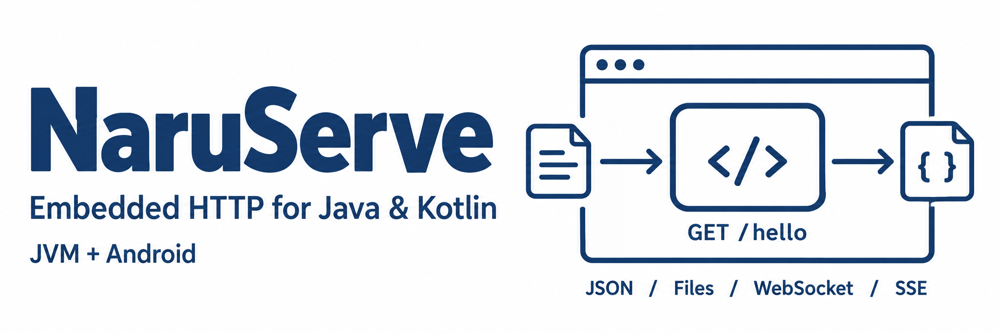

# NaruServe



[English](README.md) | 한국어

NaruServe는 Express.js처럼 사용하는 Java 8·Kotlin용 경량 HTTP 서버 라이브러리입니다.

> 이 체크아웃은 0.10.0 공통 HTTP 프로파일을 설명합니다. Maven 배포 검증 전에는 새 API를 소스 빌드로 사용하세요. 아래 공개 0.9.0 좌표는 이전 릴리스에 해당합니다.
Android 5.0(API 21) 이상과 Java 8 이상 JVM에서 같은 API를 사용합니다.

[한국어 API 문서](docs/api/README.md)와 [English API guide](docs/api/en/README.md)를 제공합니다.
아래 설치 방법과 실행 가능한 예제부터 시작하고, 메서드 시그니처·기본값·오류 계약은 API 가이드에서 확인하세요.

## 설치

NaruServe 0.9.0은 Maven Central에 공개되어 있어, Gradle이 `mavenCentral()`에서 바로 받습니다. 별도 저장소나 소스 체크아웃은 필요 없습니다.

- Central 페이지: [central.sonatype.com/artifact/com.snoworca.naruserve/naruserve](https://central.sonatype.com/artifact/com.snoworca.naruserve/naruserve)
  (전체 모듈: [namespace com.snoworca.naruserve](https://central.sonatype.com/namespace/com.snoworca.naruserve))
- 저장소 경로: [repo.maven.apache.org/maven2/com/snoworca/naruserve/](https://repo.maven.apache.org/maven2/com/snoworca/naruserve/)

`build.gradle`(Groovy DSL):

```groovy
repositories {
    mavenCentral()
}

dependencies {
    implementation 'com.snoworca.naruserve:naruserve:0.9.0'
}
```

`build.gradle.kts`(Kotlin DSL):

```kts
repositories {
    mavenCentral()
}

dependencies {
    implementation("com.snoworca.naruserve:naruserve:0.9.0")
}
```

프로젝트 종류에 맞는 한 줄만 넣으면 나머지(TinyHttpd 엔진, Gson 코덱, 로거)는 함께 따라옵니다.

| 프로젝트 | Gradle 의존성 |
|---|---|
| JDK 8 이상 Java 애플리케이션 | `implementation 'com.snoworca.naruserve:naruserve:0.9.0'` |
| Kotlin 애플리케이션 | `implementation 'com.snoworca.naruserve:naruserve-kotlin:0.9.0'` |
| Android 앱(API 21 이상) | `implementation 'com.snoworca.naruserve:naruserve-android:0.9.0'`과 아래 `pickFirsts` 설정 |

Android Studio로 만든 프로젝트는 `settings.gradle`의 `dependencyResolutionManagement`에 이미 `google()`과 `mavenCentral()`이 있으므로 따로 추가할 것이 없습니다.

`NaruServe`는 Maven Central에서 TinyHttpd 3.1.1 엔진을 가져옵니다. 아래 [TinyHttpd](#tinyhttpd)를 참고하세요.
Kotlin 프로젝트는 `NaruServe-kotlin`, Android 앱은 `NaruServe-android`에 의존하면 됩니다. 두 모듈 모두 `NaruServe`를 포함합니다.

Android 앱에는 아래 설정도 필요합니다. TinyHttpd 3.1.1의 core·websocket JAR에 같은 경로와 내용의 라이선스 고지가 있어, 이 설정이 없으면 앱의 리소스 병합이 실패합니다. 한 사본을 남겨도 라이선스 고지는 유지됩니다.

```groovy
android {
    packaging {
        resources {
            pickFirsts += ['META-INF/LICENSE-tinyhttpd.txt', 'META-INF/LICENSE-nanohttpd.txt', 'META-INF/NOTICE-tinyhttpd.txt']
        }
    }
}
```

artifactId는 모듈 이름을 소문자로 쓴 값입니다(`NaruServe-api` → `naruserve-api`).

| 모듈 | 좌표 | 내용 |
|---|---|---|
| `NaruServe-api` | `com.snoworca.naruserve:naruserve-api:0.9.0` | 공개 API와 SPI. 외부 런타임 의존성 없음(JSpecify 애너테이션은 컴파일 전용) |
| `NaruServe` | `com.snoworca.naruserve:naruserve:0.9.0` | `RestApp.create()` 기본 조립: TinyHttpd, Gson(컴파일 시점의 `GsonJsonCodec` 포함), 콘솔 로거. 일반 JDK에서 사용 |
| `NaruServe-tinyhttpd` | `com.snoworca.naruserve:naruserve-tinyhttpd:0.9.0` | TinyHttpd `HttpAdapter` |
| `NaruServe-gson` | `com.snoworca.naruserve:naruserve-gson:0.9.0` | `GsonJsonCodec`(Gson 2.14.0) |
| `NaruServe-kotlin` | `com.snoworca.naruserve:naruserve-kotlin:0.9.0` | `NaruServe`와 Kotlin 전용 확장. `kotlin-stdlib`를 사용하는 유일한 모듈 |
| `NaruServe-android` | `com.snoworca.naruserve:naruserve-android:0.9.0` | `NaruServe`, Logcat 로거, `INTERNET` 권한을 담은 Android 라이브러리(AAR). Android SDK가 있을 때만 빌드 |
| `NaruServe-logcat` | `com.snoworca.naruserve:naruserve-logcat:0.9.0` | Logcat `Logger` |
| `NaruServe-filelog` | `com.snoworca.naruserve:naruserve-filelog:0.9.0` | 파일 로테이션 `Logger` |
| `NaruServe-slf4j` | `com.snoworca.naruserve:naruserve-slf4j:0.9.0` | SLF4J `Logger` 어댑터(JVM 전용) |
| `NaruServe-servlet` | `com.snoworca.naruserve:naruserve-servlet:0.9.0` | Servlet 3.1 이상 컨테이너에서 NaruServe 앱을 실행하는 어댑터(JVM 전용) |

### 소스 체크아웃 빌드

**JDK 17**과 저장소의 **Gradle 8.14.3** wrapper로 빌드합니다. 라이브러리 바이트코드 대상은 Java 8이며, 빌드 JDK와 실행 환경의 최소 버전은 다릅니다. `java -version`과 `./gradlew --version`으로 확인하세요.

아래 명령은 배포된 TinyHttpd JAR를 사용하므로 TinyHttpd 체크아웃이 필요 없습니다.

```bash
./gradlew -PtinyHttpdFromMaven=true build
./gradlew -PtinyHttpdFromMaven=true publishToMavenLocal
```

이 로컬 빌드를 별도 소비자 프로젝트에서 사용하려면 `mavenCentral()` 앞에 `mavenLocal()`을 추가하세요.

```groovy
repositories {
    mavenLocal()
    mavenCentral()
}
```

Android AAR는 `local.properties`의 `sdk.dir`, `ANDROID_HOME`, `ANDROID_SDK_ROOT` 순으로 SDK 디렉터리를 찾아 포함합니다. Android Gradle Plugin 8.13.2, `compileSdk 36`, `minSdk 21`을 사용합니다. SDK가 없어도 아홉 JAR 모듈을 빌드합니다.

TinyHttpd 소스를 수정하려면 `-PtinyHttpdFromMaven=true` 대신 `-PtinyHttpdDir=/absolute/path/to/TinyHttpd`를 사용하세요. 기본 소스 경로는 원래 개발 머신에 맞춰져 있으므로 새 체크아웃에서는 두 속성 중 하나를 명시하세요.

## 빠른 시작

### Java

```java
import com.snoworca.naruserve.RestApp;

public class HelloServer {
    public static void main(String[] args) {
        RestApp.start(3000, app -> app.get("/hello", (req, res) -> res.send("Hello World")));
    }
}
```

### Kotlin

```kotlin
import com.snoworca.naruserve.RestApp

fun main() {
    RestApp.start(3000) { app -> app.get("/hello") { _, res -> res.send("Hello World") } }
}
```

전체 [Java](examples/java)·[Kotlin](examples/kotlin) 앱 예제에는 DTO 검증, 스레드 안전한 사용자 서비스, 업로드, 스트리밍이 포함되어 있습니다. [예제 실행 안내](examples/README.ko.md)를 참고하세요.

JDK 17로 이 체크아웃에서 예제 하나를 실행합니다.

```bash
./gradlew -p examples/java -PtinyHttpdFromMaven=true run
# 또는 Kotlin:
./gradlew -p examples/kotlin -PtinyHttpdFromMaven=true run
```

다른 터미널에서 `curl http://127.0.0.1:3000/hello`로 확인하세요. `RestApp.start`는 `127.0.0.1`에서만 요청을 받고(현재 기기 전용), `Listening on ...` 로그 한 줄을 남기며 Ctrl+C로 종료합니다. LAN에 공개하려면 설정 람다 안에서 `app.server(o -> o.bindAddress("0.0.0.0"))`를 호출하세요. `RestApp.create()`와 `app.listen(...)`을 사용하는 하위 수준 경로도 제공합니다.
예제는 이 체크아웃을 Gradle composite build로 사용하며, 로컬 Maven 게시가 필요 없습니다.
별도 소비자 프로젝트는 [설치](#설치)의 좌표를 사용합니다. 저장소에서 릴리스를 찾지 못하면 소스 체크아웃 설치 방법을 사용하세요.

## Express와 비교

NaruServe는 라우트와 미들웨어를 등록하고 요청을 읽어 응답하는 API 구조가 Express와 유사합니다. 아래 두 서버는 모두 `X-Example: demo` 헤더를 설정하고, `GET /users/42`에 `{"id":"42"}`를 반환합니다.

### Express 5 (JavaScript)

Node.js 18 이상과 npm이 필요합니다([Express 설치 전제조건](https://expressjs.com/en/starter/installing/)). `server.cjs`로 저장한 뒤 `npm install express@5`, `node server.cjs`를 실행하세요.

```javascript
const express = require('express');
const app = express();

app.use((req, res, next) => {
  res.set('X-Example', 'demo');
  next();
});

app.get('/users/:id', (req, res) => {
  res.status(200).json({ id: req.params.id });
});

app.listen(3000, '127.0.0.1');
```

### NaruServe (Java)

설치 절의 `naruserve` 의존성을 추가하고, 앱의 Java 소스 디렉터리에 `ExpressStyleServer.java`로 저장해 `main`을 실행하세요.

```java
import com.snoworca.naruserve.RestApp;
import java.util.Collections;

public class ExpressStyleServer {
    public static void main(String[] args) {
        RestApp app = RestApp.create();

        app.use((req, res, next) -> {
            res.header("X-Example", "demo");
            next.run();
        });

        app.get("/users/:id", (req, res) -> {
            res.status(200).json(Collections.singletonMap("id", req.param("id")));
        });

        app.listen(3000);
    }
}
```

서버는 하나씩 실행한 뒤 같은 루프백 URL로 요청하세요.

```bash
curl -i http://127.0.0.1:3000/users/42
```

두 서버 모두 HTTP 200, 위 사용자 정의 헤더와 JSON 본문을 반환합니다. Express 예제에는 `127.0.0.1`을 명시해 NaruServe의 기본 바인딩과 맞췄습니다.

| 작업 | Express | NaruServe |
|---|---|---|
| 앱 생성 | `express()` | `RestApp.create()` |
| GET 라우트 등록 | `app.get('/users/:id', handler)` | `app.get("/users/:id", handler)` |
| 다음 미들웨어 실행 | `next()` | `next.run()` |
| 경로 변수 읽기 | `req.params.id` | `req.param("id")` |
| 상태 지정과 JSON 응답 | `res.status(200).json(value)` | `res.status(200).json(value)` |

0.10.0 공통 HTTP 프로파일은 Express 5의 등록 순서, 이름 있는 와일드카드와 선택 그룹, Router 마운트, 매개변수 콜백, route/router 건너뛰기, HEAD/OPTIONS, HTML 최종 응답을 따릅니다. 저장소의 차등 검증 코퍼스는 Express 5.1.0을 고정합니다. 검증 범위는 [마이그레이션 가이드](docs/api/express-migration.md)에서 확인하세요.

정규식에는 Java `Pattern`을 사용합니다. 타입을 지정한 본문 읽기, 일반 텍스트 `res.send("text")`, 입력 제한, 정적 파일 보호, 기존 WebSocket API는 NaruServe 기능으로 유지합니다. 저장한 `Next`나 반환한 `Deferred`로 콜백 이후에도 작업을 이어갈 수 있습니다. 핸들러가 동시에 실행될 수 있으므로 공유 가변 상태를 보호하세요. `Deferred`를 resolve해도 `next.run()`이나 응답 종료가 자동 실행되지는 않습니다.

Express 5 공식 [라우팅 가이드](https://expressjs.com/en/guide/routing/), [미들웨어 가이드](https://expressjs.com/en/guide/using-middleware/), [응답 API](https://expressjs.com/en/5x/api/response/)와 대조했습니다.

## API 안내

NaruServe는 앱에 내장하는 서버 라이브러리입니다. 애플리케이션의 엔드포인트는 직접 정의하며, 이 저장소가 고정된 REST 서비스를 제공하지는 않습니다.

| 작업 | 공개 API | 가이드 |
|---|---|---|
| 앱 시작·설정 | `RestApp.start(int, Configurer<RestApp>)`, `create()`, `builder()` | [앱](docs/api/app.md) |
| 라우트·그룹 등록 | `get`, `post`, `route`, `group`, `Router.create()` | [라우팅](docs/api/routing.md) |
| 입력 읽기·검증 | `Request.param`, `queryInt`, `requireQuery`, `body`, `requireFile` | [Request](docs/api/request.md) |
| 응답 전송 | `Response.status`, `send`, `json`, `file`, `stream` | [Response](docs/api/response.md) |
| 공통 동작 처리 | `use`, `cors`, `onError`, `next.run()` | [미들웨어](docs/api/middleware.md) |
| 연결 유지 | `ws`, `Response.sse` | [WebSocket](docs/api/websocket.md), [SSE](docs/api/sse.md) |
| 지연 작업 재개 | `getAsync`, `methodAsync`, `useAsync`, `Deferred`, 저장한 `Next` | [미들웨어](docs/api/middleware.md), [수명주기](docs/api/lifecycle.md) |
| 앱 서비스 관리 | `onStart`, `onStop`, `ApplicationContext` | [수명주기](docs/api/lifecycle.md) |

서버 옵션, 서비스, WebSocket 라우트는 리스닝 전에 설정하세요. 일반 HTTP 라우트는 실행 중에도 추가할 수 있으며 등록 순서대로 실행됩니다. 저장한 `Next`는 콜백 반환 후에도 재개할 수 있으므로 continuation과 응답 작업을 직렬화하세요. `res.stream(...)` 뒤에는 NaruServe가 스트림을 소유하고 닫습니다. 비동기 콜백이 반환한 pending `Deferred`는 먼저 응답을 보낸 뒤에도 요청 자원을 유지합니다. 생산자가 요청·업로드 자원에 마지막으로 접근한 뒤 settle하세요. 취소와 강제 종료는 이 소유권을 끝냅니다. 전체 계약은 연결된 가이드에서 확인하세요.

## 저장소 구조

```text
NaruServe-api/          공개 인터페이스, 라우팅, 공통 헬퍼, 내부 구현과 SPI
NaruServe/              기본 앱 팩토리(TinyHttpd + Gson)
NaruServe-tinyhttpd/    내장 HTTP/WebSocket 엔진 어댑터
NaruServe-gson/         기본 JSON 코덱
NaruServe-kotlin/       reified Kotlin 확장
NaruServe-android/      매니페스트만 포함한 Android AAR
NaruServe-servlet/      Servlet 3.1 어댑터
NaruServe-{filelog,slf4j,logcat}/  선택적 로거 어댑터
examples/{java,kotlin}/ 실행 가능한 앱
src/test/              빌드·게시·문서 검사
docs/api/              한국어 가이드와 en/의 영문판
docs/spec/             요구사항 원본
build.gradle           모든 모듈의 공통 설정
settings.gradle        모듈 포함과 선택적 TinyHttpd composite
```

## 문제 해결

| 증상 | 원인과 조치 |
|---|---|
| `tinyHttpdDir: TinyHttpd checkout not found` | `-PtinyHttpdFromMaven=true`로 배포된 엔진 JAR를 선택하거나 유효한 `-PtinyHttpdDir` 경로를 넘기세요. |
| `Could not find com.snoworca.naruserve:...:0.9.0` | 릴리스 가용성을 확인하고, 이 체크아웃을 로컬에 게시한 뒤 소비자에 `mavenLocal()`을 추가하세요. |
| `No com.snoworca.naruserve.spi.AppFactory provider found` | `naruserve`(또는 `naruserve-kotlin` / `naruserve-android`)를 추가하거나 `RestApp.builder()`에 `httpAdapter`와 `jsonCodec`을 명시하세요. `naruserve-api`만으로는 인터페이스와 구현 기반 요소만 제공합니다. |
| 다른 기기에서 연결할 수 없음 | 기본 바인딩은 `127.0.0.1`입니다. 설정 람다에서 `bindAddress("0.0.0.0")`를 지정하고 기기 네트워크·방화벽을 확인하세요. |
| Android 리소스 병합에서 TinyHttpd 고지가 중복됨 | 설치 절의 `packaging.resources.pickFirsts` 설정을 적용하세요. |

## v1 범위

아래는 Android AAR 모듈을 추가하기 전인 **2026-10-20에 결정한 초기 v1 검증 범위**입니다. 현재 소스에서는 위 안내대로 AGP 기반 AAR를 빌드할 수 있습니다. AAR 빌드와 로컬 스테이징 검사는 API 21 기기·에뮬레이터 검증을 입증하지 않습니다. 아래 컴파일 클래스패스 설명은 초기 Java 모듈 구성을 기준으로 합니다.

Android 샘플 빌드와 API 21 기기·에뮬레이터 검증은 v1 범위에 포함되지 않습니다.
API 21 호환성의 근거는 `--release 8` 컴파일과, API 문서에서 Android 지원으로 표시한 각 모듈에 빌드가 실행하는 animal-sniffer `android-api-level-21` 검사입니다.
2026-10-20 사용자 결정에 따라 Android 샘플 빌드, AGP·R8 빌드, StrictMode, 기기에서의 Logcat, API 21 기기·에뮬레이터 실행은 v1 범위 밖입니다. 이 결정으로 이슈 #17을 닫았으며(2026-10-20) 남은 산출물이 없습니다.
API 21 근거의 세 번째 부분은 D-385 규칙입니다. 어떤 모듈도 컴파일 시점의 `android.*` 참조를 갖지 않으며, 빌드의 `checkClassReferences` 검사는 `NaruServe-api`와 `NaruServe-logcat`의 `android/` 클래스 참조를 거부합니다. 어떤 모듈의 컴파일 클래스패스에도 Android 아티팩트를 넣지 않습니다.

- [API 문서](docs/api/README.md)
- [릴리스 노트](docs/release/release-notes.md)
- [테스트 결과](docs/release/test-results.md)
- [서드파티 라이선스](THIRD-PARTY-LICENSES.md)

## TinyHttpd

이 저장소는 TinyHttpd를 게시하지 않습니다. 어댑터는 Maven Central의 `com.snoworca:tinyhttpd-core:3.1.1`과 `com.snoworca:tinyhttpd-websocket:3.1.1`으로 버전을 고정합니다.
이 어댑터는 TinyHttpd 3.1.1에 추가된 `RequestTargetPolicy.RAW` API를 사용합니다. 두 아티팩트 모두 3.1.1을 사용하세요. 3.1.0에는 이 정책이 없습니다.

로컬에 게시한 NaruServe 모듈을 별도 소비자에서 쓰려면 `mavenLocal()`과 `mavenCentral()`을 함께 설정하세요. TinyHttpd 소스 체크아웃은 필요 없습니다. 배포된 JAR로 이 저장소를 빌드하는 명령은 다음과 같습니다.

```bash
./gradlew -PtinyHttpdFromMaven=true build
```

기본 저장소 빌드는 `tinyHttpdDir`의 소스 composite를 사용합니다. `-PtinyHttpdDir=/path/to/TinyHttpd`로 경로를 바꾸세요. NaruServe는 TinyHttpd 커밋 `e73cd5d`(태그 `v3.1.1`, 버전 3.1.1)를 사용합니다.
어댑터는 `RequestTargetPolicy.RAW`를 선택하여 인코딩된 경로와 원본 쿼리를 프레임워크 라우팅에 전달합니다.
TinyHttpd의 HTTP 구문·Host·프레이밍 검사는 유지되며, 단독 사용 시 기본 정책은 `STRICT`입니다.
검증 범위는 [통합 검증 기록](docs/release/verification/tinyhttpd-3.1.1.md)을 참고하세요.
소비자도 `settings.gradle`에서 소스 빌드를 선택할 수 있습니다.

```groovy
includeBuild('/path/to/TinyHttpd')
```

## 라이선스

NaruServe는 BSD 3-Clause License로 배포합니다([LICENSE](LICENSE)). 함께 제공하는 의존성의 라이선스는 [THIRD-PARTY-LICENSES.md](THIRD-PARTY-LICENSES.md)에 있습니다.
